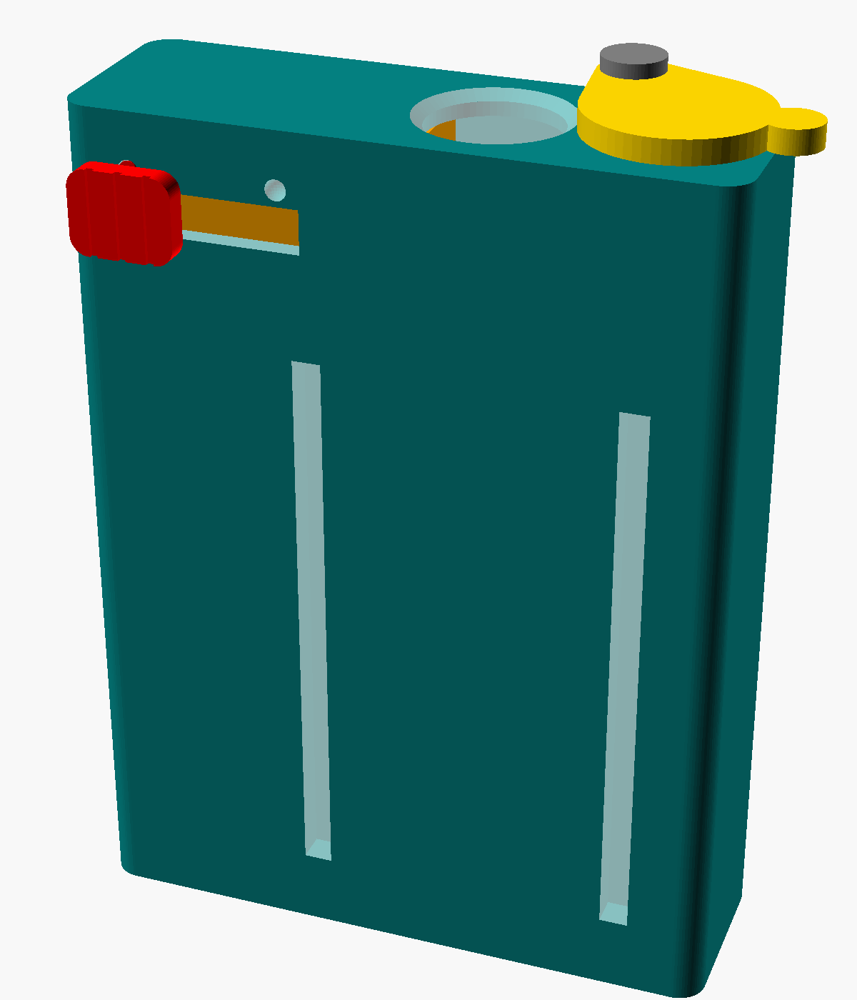
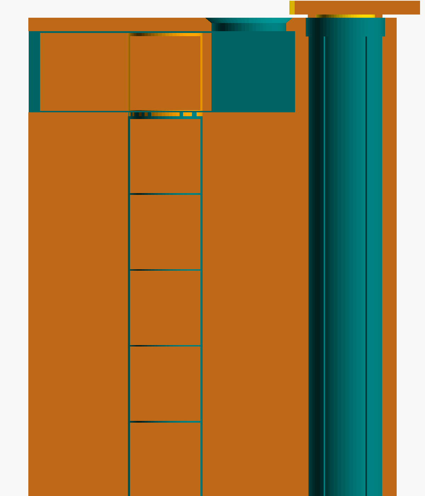

# XMAX V3/V4 Pro capsule loader and unloader

There are two printable devices here:

1. **Pocket capsule pack** (`portable_capsule_pack.scad`): carry 6 filled capsules and reload the vaporiser one-handed while you're out.
2. **Home filling station** (`xmax_capsule_station.scad`): fill and tamp 6 capsules at once, then load them into the pack.

---

## 1. Pocket capsule pack

About the size of a cigarette packet: **68 × 22 × 90 mm**.

| Front | Cutaway |
|---|---|
|  |  |

- **Full side** holds 6 filled capsules: 5 in a column plus 1 waiting in a sliding shuttle. To load the vaporiser, hold the pack top-down over the open chamber and slide the thumb button across. Exactly one capsule drops out. Slide the button back to queue the next one. The windows on the front show how many are left.
- **Spent side** holds 6 used capsules. Swing the lid open, tip the vaporiser over the hole, and swing the lid shut. To empty it at home, open the lid and tip it out.
- **Refill at home:** stand the pack upright and slide the button across. Drop a capsule into the exit hole, then slide the button back so it falls into the column. Repeat up to 6 times.

### Parts (all printed, no supports)

| STL | Qty | Print | Assembly |
|---|---|---|---|
| `pack_body.stl` | 1 | Upright, with a brim (it's tall and thin) | |
| `pack_shuttle.stl` | 1 | Flat | Slides into the open slot on the right-hand side |
| `pack_nub.stl` | 1 | Grip face down | Push its peg through the front slot into the shuttle. Add a drop of superglue if it's loose. |
| `pack_lid.stl` | 1 | As it comes | |
| `pack_pin.stl` | 1 | Head down | Goes through the lid into the hole on top. A drop of glue in the **body** hole only, so the lid can still swing. |

**Material: PETG or ASA, not PLA.** Spent capsules come out of the oven very hot. PLA softens at about 60 °C and will be marked or deformed by them. The spent bore has stand-off ribs and vents to keep contact and heat down, but give a capsule about 30 seconds to cool before you tip it in.

### Measure first

The escapement depends on the capsule's **closed length** (`cap_len`) and its **widest diameter** (`lid_d`). If `cap_len` is set too short, the shuttle jams. If it's set too long, two capsules can drop at once. Measure a filled, closed capsule with calipers, edit the top of `portable_capsule_pack.scad`, and rebuild:

```
for p in body shuttle nub lid pin; do
  openscad -D "part=\"$p\"" -o stl/pack_$p.stl portable_capsule_pack.scad
done
```

If the button doesn't click into place at each end, raise `detent` a little. If it's too stiff, lower it.

---

## 2. Home filling station

The home station loads, packs, and unloads **6 dosing capsules at once**. Set `N_CAPS` to change the count.


| Part | What it does | Print orientation (already set in the STL) |
|---|---|---|
| `base` | Holds 6 capsules in wells with crush ribs, so you can twist lids off one-handed. Also has 6 lid parking pockets and a tap-out bin for spent herb, with a wall in the middle to knock capsules against. | Upside down (top face on the bed) |
| `funnel` | Sits on two pegs over all 6 capsules. Each spout dips into a capsule's mouth. Pour ground herb into the tray and sweep it across with a card. | Upside down (rim on the bed) |
| `tamper` | Rests on the funnel rim and pushes 6 pins down through the funnels. Every capsule gets packed to the same depth (`tamp_depth`). | Handle on the bed |
| `ejector` | Put it on the table and press the base down over it. The pins push up through the floor holes and lift all 6 capsules out together. | Flat |
| `fit_test` | A single well for checking grip before you print the full base (about 5 minutes). | Flat |

## Before printing: measure your capsule

XMAX doesn't publish capsule drawings, so the defaults are estimates. Measure a capsule with calipers and edit the top of `xmax_capsule_station.scad`:

```
cap_d       = 12.5; // outside diameter of capsule body
cap_body_h  = 11.0; // body height with lid removed
cap_inner_d = 11.0; // inside diameter of the open mouth
lid_d       = 13.0; // outside diameter of the lid
```

Then print `fit_test`. Push a capsule in and twist its lid:
- **Body spins in the well:** raise `rib_grip` (try 0.25).
- **Too tight to push in:** lower `rib_grip` (try 0.05) or raise `clearance`.

## Build the STLs

```
for p in base funnel tamper ejector fit_test; do
  openscad -D "part=\"$p\"" -o stl/$p.stl xmax_capsule_station.scad
done
```

The STLs already in `stl/` use the default dimensions. PLA or PETG, 0.2 mm layers, 3 walls, 15–20 % infill, no supports.

## How to use it

**Loading**
1. Put the empty capsule bodies in the wells and park the lids in the front pockets.
2. Fit the funnel, pegs into the sockets.
3. Pour herb into the tray and sweep it into the funnels.
4. Press the tamper down until it rests on the funnel rim. Lift the funnel off.
5. Twist the lids back on while the bodies are held in the wells.

**Unloading**
1. Set the ejector on the table and press the base down over it. All capsules pop up about 5.5 mm.
2. Twist the lids off and tap each capsule on the bin wall to empty it.
3. Tip the bin out over a bin or bag.
