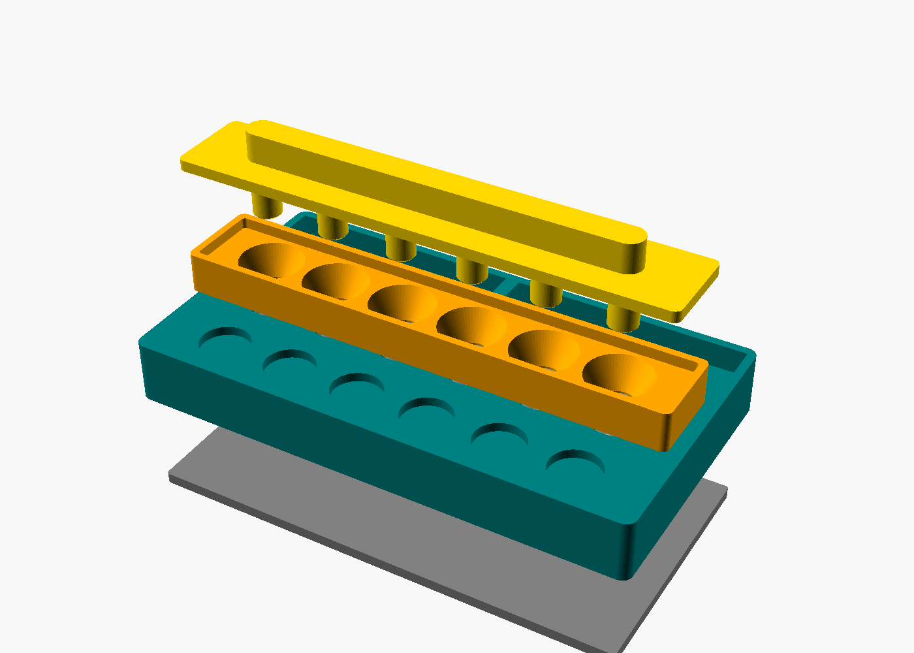

# XMAX V3/V4 Pro capsule loader and unloader

A 3D-printable station that loads, packs, and unloads **6 dosing capsules at once**. Set `N_CAPS` to change the count.



| Part | What it does | Print orientation (already set in the STL) |
|---|---|---|
| `base` | Holds 6 capsules in wells with crush ribs, so you can twist lids off one-handed. Also has 6 lid parking pockets and a tap-out bin for spent herb, with a wall in the middle to knock capsules against. | Upside down (top face on the bed) |
| `funnel` | Sits on two pegs over all 6 capsules. Each spout dips into a capsule's mouth. Pour ground herb into the tray and sweep it across with a card. | Upside down (rim on the bed) |
| `tamper` | Rests on the funnel rim and pushes 6 pins down through the funnels. Every capsule gets packed to the same depth (`tamp_depth`). | Handle on the bed |
| `ejector` | Put it on the table and press the base down over it. The pins push up through the floor holes and lift all 6 capsules out together. | Flat |
| `fit_test` | A single well for checking grip before you print the full base (about 5 minutes). | Flat |

## Before printing: measure your capsule

XMAX doesn't publish capsule drawings, so the defaults are estimates. Measure a capsule with calipers and edit the top of `xmax_capsule_station.scad`:

```
cap_d       = 12.5; // outside diameter of capsule body
cap_body_h  = 11.0; // body height with lid removed
cap_inner_d = 11.0; // inside diameter of the open mouth
lid_d       = 13.0; // outside diameter of the lid
```

Then print `fit_test`. Push a capsule in and twist its lid:
- **Body spins in the well:** raise `rib_grip` (try 0.25).
- **Too tight to push in:** lower `rib_grip` (try 0.05) or raise `clearance`.

## Build the STLs

```
for p in base funnel tamper ejector fit_test; do
  openscad -D "part=\"$p\"" -o stl/$p.stl xmax_capsule_station.scad
done
```

The STLs already in `stl/` use the default dimensions. PLA or PETG, 0.2 mm layers, 3 walls, 15–20 % infill, no supports.

## How to use it

**Loading**
1. Put the empty capsule bodies in the wells and park the lids in the front pockets.
2. Fit the funnel, pegs into the sockets.
3. Pour herb into the tray and sweep it into the funnels.
4. Press the tamper down until it rests on the funnel rim. Lift the funnel off.
5. Twist the lids back on while the bodies are held in the wells.

**Unloading**
1. Set the ejector on the table and press the base down over it. All capsules pop up about 5.5 mm.
2. Twist the lids off and tap each capsule on the bin wall to empty it.
3. Tip the bin out over a bin or bag.
